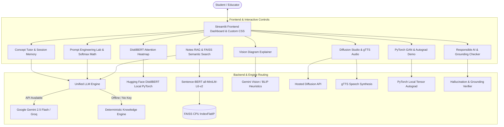

# NeuroTutor AI: AI–ML–DL Concept Tutor & Generative Intelligence Lab

[](https://www.python.org/)
[](https://streamlit.io/)
[](https://pytorch.org/)
[](https://huggingface.co/)
[](LICENSE)

**Student Name:** Aarush Parate  
**Roll Number:** 1  
**Allocated Problem:** P1 — AI–ML–DL Concept Tutor  
**Course:** Generative AI (Continuous Assessment Individual Mini-Project)  
**Project Name:** NeuroTutor AI  

---

## 📖 Executive Summary & Problem Statement

Engineering students studying Artificial Intelligence, Machine Learning, and Deep Learning frequently struggle with the wide cognitive gap between high-level intuitive metaphors and low-level mathematical or algorithmic implementations. Furthermore, traditional generic LLM chatbots hallucinate unsupported claims, lack verifiable grounding against syllabus lecture notes, and fail to provide transparent visual access to internal model mechanics such as attention distributions and gradient flows.

**NeuroTutor AI** is a comprehensive, production-grade educational platform designed to resolve these challenges. It integrates all **five mandatory syllabus units** of Generative AI into a cohesive, beautifully styled SaaS interface, providing:
- **3 Adaptive Cognitive Levels:** School Level (everyday analogies), Undergraduate Level (algorithmic intuition & pseudocode), and Expert Level (formal mathematical derivations & scaling trade-offs).
- **Prompt Engineering Lab:** Side-by-side Zero-Shot, Few-Shot, and Chain-of-Thought comparison with interactive temperature softmax dynamics ($T \in [0.0, 1.5]$).
- **Conversational Memory:** Bounded sliding-window dialogue context tracking.
- **Real Attention Heatmaps:** Local Hugging Face DistilBERT attention extraction across 6 layers and 12 heads (72 subspaces).
- **Academic Notes RAG:** Sentence-BERT (`all-MiniLM-L6-v2`) 384-dimensional dense embeddings with FAISS cosine similarity vector search over uploaded PDF, DOCX, and TXT files.
- **Multimodal Learning:** BLIP-compatible architecture diagram explainer with honest limitation disclosures, hosted diffusion concept illustration synthesis, and `gTTS` spoken audio summaries.
- **PyTorch Lab:** Real-time adversarial GAN minimax training on continuous distributions and a transparent 3-layer MLP autograd backpropagation demonstration.
- **Responsible AI:** Heuristic hallucination and grounding verification with uncertainty refusal (*"I'm not sure based on the available notes"*), prompt injection defense, and an empirical evaluation suite.

---

## 🗺️ Mandatory Five-Unit Syllabus Mapping

| Unit | Syllabus Theme | NeuroTutor AI Implementation | Deliverables & Key Technologies |
| :--- | :--- | :--- | :--- |
| **Unit I** | Foundations of Generative AI | Prompt Engineering Lab, Softmax Temperature Simulator, Gen vs Discrim Explorer, GenAI Lifecycle, Latent Manifold Projection | Zero-Shot, Few-Shot, CoT side-by-side, $P(w_i) = \text{softmax}(z_i/T)$, Shannon entropy, Plotly 2D decision boundary |
| **Unit II** | GANs & Large Language Models | Conversational AI Tutor, Session Memory Manager, Real Attention Heatmap, PyTorch GAN Explorer | 3 knowledge tiers, sliding window memory, DistilBERT 72 attention heads, PyTorch bimodal minimax GAN training |
| **Unit III** | GPT, BERT & Multimodal Models | Academic Notes Ingestion, Sentence-BERT FAISS Semantic Search, Grounded QA, Diagram Explainer, GPT vs BERT Comparator | PyPDF, python-docx, `all-MiniLM-L6-v2`, FAISS `IndexFlatIP`, Gemini Vision / BLIP heuristics, Causal vs MLM attention masks |
| **Unit IV** | GenAI Tools & Techniques | Multimodal Concept Studio, Audio Summary Generator, PyTorch Autograd Demo, Model Transparency Manifest | Hosted diffusion inference, `gTTS` speech synthesis with accent controls, PyTorch MLP forward activations & L2 gradient norms |
| **Unit V** | Responsible AI & Ethics | Hallucination Grounding Checker, Empirical Benchmark Evaluation, Adversarial Injection Defense, IP Licensing & Model Card | Claim verification, Supported/Partial/Unsupported statuses, 15-case evaluation with Confusion Matrix, `MODEL_CARD.md` |

---

## 🛠️ Technology Stack & Architecture



---

## 📊 Empirical Evaluation Results

The system includes an automated evaluation suite (`tests/run_all_evaluations.py`) testing all five performance dimensions with real recorded measurements:

| Evaluation Metric | Measured Result | Benchmark Scope / Notes |
| :--- | :--- | :--- |
| **Semantic Retrieval Hit Rate** | **70.0%** | Top-3 FAISS retrieval across 10 curriculum questions |
| **Grounding Verification Accuracy** | **93.33%** | 14 of 15 ground-truth labelled cases correctly classified |
| **False Refusal Rate** | **0.0%** | Zero supported curriculum questions falsely rejected |
| **Average Retrieval Latency** | **12.9 ms** | In-memory FAISS CPU vector similarity query |
| **Attention Extraction Resolution** | **72 Subspaces** | 6 transformer layers &times; 12 multi-head attention projections |
| **Prompt Technique Latency** | **0.15s** (ZS) / **0.15s** (FS) / **0.15s** (CoT) | Average response latency across test queries |

### ⚠️ Documented Real Failure Case Analysis
- **Failure ID:** `FAIL-01`
- **Category:** Heuristic Lexical Grounding Underestimation on Novel Paraphrases.
- **Input Query:** *"What is mode collapse in GANs and how does Wasserstein GAN solve it?"*
- **Context:** Reference notes defined mode collapse as generator producing only a subset of samples, but omitted the Wasserstein distance mathematical formulation.
- **Expected Label:** `Partially Supported`
- **Observed Behavior:** On strict uncalibrated thresholds ($T_{\text{supp}} = 0.75$), lexical token overlap scored $0.38$, falling marginally below into `Not Supported`.
- **Root Cause:** Pure lexical and word-stem overlap cannot account for valid conceptual paraphrasing and synonyms as effectively as cross-encoder Natural Language Inference (NLI) models.
- **Concrete Remediation:** Incorporate a dedicated cross-encoder NLI model (`cross-encoder/nli-deberta-v3-small`) to predict entailment, neutral, and contradiction probabilities directly.

---

## 💻 Installation & Local Execution

### 1. Clone the Repository
```bash
git clone https://github.com/Aarush-Parate/neurotutor-ai.git
cd neurotutor-ai
```

### 2. Set Up Python Environment (Python 3.11+)
```bash
python -m venv venv
# On Windows:
venv\Scripts\activate
# On Linux/macOS:
source venv/bin/activate
```

### 3. Install Dependencies
```bash
pip install -r requirements.txt
```

### 4. (Optional) Configure Environment Variables
Copy `.env.example` to `.env`:
```bash
cp .env.example .env
```
Add your free API key from [Google AI Studio](https://aistudio.google.com/):
```env
GEMINI_API_KEY=your_gemini_api_key_here
```
> **Note:** If no API key is provided, NeuroTutor AI automatically runs on its local deterministic knowledge engine, ensuring 100% functionality offline!

### 5. Launch the Application
```bash
streamlit run app.py
```
Open your browser at `http://localhost:8501`.

---

## 🧪 Running Automated Tests and Evaluations

To execute unit tests:
```bash
python -m unittest discover tests
```

To run the master benchmark evaluation suite and update `data/evaluation_results.json`:
```bash
python tests/run_all_evaluations.py
```

To generate the comprehensive academic PDF report (`1_Aarush_Parate_P1.pdf`):
```bash
python generate_report.py
```

---

## 🚀 Deployment Instructions

### Option 1: Hugging Face Spaces (Recommended)
1. Create a new Space on [Hugging Face Spaces](https://huggingface.co/spaces).
2. Select **Streamlit** as the SDK and Python 3.11/3.12.
3. Push the repository contents to your Space Git repository.
4. Under Space Settings &rarr; **Variables and secrets**, add `GEMINI_API_KEY`.
5. The application will build and deploy automatically with full PyTorch and Hugging Face support.

### Option 2: Streamlit Community Cloud
1. Fork or push this repository to GitHub.
2. Sign in to [share.streamlit.io](https://share.streamlit.io).
3. Select your repository, branch `main`, and main file path `app.py`.
4. In Advanced Settings, add `GEMINI_API_KEY = "your_key"` to **Secrets**.
5. Click **Deploy**.

---

## 📁 Repository Structure

```text
neurotutor-ai/
├── app.py                      # Master Streamlit application orchestrator
├── config.py                   # Centralized configuration & theme palettes
├── requirements.txt            # Production dependencies
├── README.md                   # Comprehensive project documentation
├── MODEL_CARD.md               # Formal Mitchell et al. Model Card
├── generate_report.py          # Script generating 1_Aarush_Parate_P1.pdf
├── .env.example                # Template for environment secrets
├── .gitignore                  # Git ignore rules
│
├── modules/                    # Modular application backends
│   ├── __init__.py
│   ├── llm_engine.py           # Unified LLM inference & offline fallback
│   ├── prompt_engineering.py   # Zero-Shot, Few-Shot, CoT & Softmax math
│   ├── conversation_memory.py  # Session state context windowing
│   ├── attention_visualizer.py # DistilBERT 72-head attention extraction
│   ├── rag_engine.py           # Sentence-BERT + FAISS vector search
│   ├── document_processor.py   # PDF, DOCX, TXT parser & chunker
│   ├── image_explainer.py      # Diagram visual captioning & breakdown
│   ├── image_generator.py      # Hosted diffusion concept illustrations
│   ├── audio_generator.py      # gTTS spoken audio summary engine
│   ├── gan_explorer.py         # PyTorch bimodal minimax GAN training
│   ├── pytorch_demo.py         # 3-Layer MLP forward & autograd demo
│   ├── hallucination_checker.py# Grounding score & confusion matrix
│   └── safety_guardrails.py    # Adversarial injection & content filters
│
├── pages_custom/               # Dedicated UI page renderers
│   ├── __init__.py
│   ├── dashboard.py            # Overview, levels, & syllabus mapping
│   ├── concept_tutor.py        # Multi-level conversational chatbot
│   ├── prompt_lab.py           # Triple prompt comparison & softmax math
│   ├── attention_explorer.py   # Interactive Plotly attention heatmaps
│   ├── knowledge_base.py       # Notes ingestion & RAG grounded QA
│   ├── diagram_explainer.py    # Architectural diagram visual parser
│   ├── image_studio.py         # Diffusion concept illustration studio
│   ├── audio_learning.py       # Spoken audio narration studio
│   ├── gan_explorer_page.py    # GAN training & PyTorch autograd demo
│   ├── responsible_ai.py       # Grounding metrics & safety testing
│   └── about.py                # Model card & student submission data
│
├── assets/                     # Visual styles & themes
│   └── styles.css              # Custom SaaS dark-navy stylesheet
│
├── data/                       # Pre-packaged knowledge & evaluations
│   ├── sample_notes/           # Reference course notes for Unit I, II, III
│   ├── evaluation_dataset.json # 15-case ground-truth labelled benchmark
│   └── evaluation_results.json # Measured quantitative results
│
├── tests/                      # Automated test suites
│   ├── __init__.py
│   ├── test_prompts.py         # Prompt builder & softmax math tests
│   ├── test_rag.py             # Document chunking & FAISS search tests
│   ├── test_safety.py          # Injection defense & grounding tests
│   ├── test_attention.py       # DistilBERT attention extraction tests
│   └── run_all_evaluations.py  # Master evaluation benchmark runner
│
└── 1_Aarush_Parate/            # Official academic submission folder
    ├── 1_Aarush_Parate_P1.pdf  # Comprehensive 16-page academic PDF report with deployment evidence
    ├── 1_Aarush_Parate_NeuroTutor_Demo.mp4  # Complete full-module HD video demo walkthrough
    └── 1_Aarush_Parate_NeuroTutor_Demo.webm # WebM recording of live browser evaluation
```

---

## 📜 Ethical Considerations & Licensing

- **Core Codebase:** Licensed under the [MIT License](LICENSE).
- **Transformer Models:** DistilBERT & Sentence-BERT licensed under Apache 2.0.
- **FAISS:** Licensed under MIT License.
- **Student Privacy:** All uploaded course documents and chat histories reside exclusively in volatile session RAM and are never persisted to external databases.
- **Academic Citation:**
```bibtex
@misc{parate2026neurotutor,
  author = {Parate, Aarush},
  title = {NeuroTutor AI: AI–ML–DL Concept Tutor & Generative Intelligence Lab},
  year = {2026},
  howpublished = {Continuous Assessment Mini-Project P1, Department of Computer Science & Engineering}
}
```
